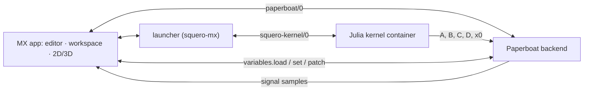

# Squero Studio MX

An open-source, **MATLAB-like workbench** for Paperboat. MX is the MATLAB side: scripts, matrices,
a live workspace, 2D graphs and 3D plots. Paperboat is the Simulink side: flow graphs,
`state_space`/`rhs` blocks, the in-house solvers, runs and signals.

MX is **not** a MATLAB compatibility product. It does not run `.m` files; it gives the feel
(1-based indexing, `A'*A`, `A\b`, `.*`, `end`, a command line, a workspace) on a Julia kernel.

## The four goals of this scaffold

1. **Share variables with Paperboat when MX is running.**
   - Paperboat's project variables are scalars, booleans and text. MX publishes its shareable
     scalars by name (`k` → Paperboat `k`) through `variables.set`; Paperboat's `variables.load`
     and `variables.patch` flow back into the workspace.
   - Matrices and vectors are **not** project variables. They travel as `Table`/`matrix` handles
     into `state_space` or matrix blocks.
   - When MX is not running or not attached, Paperboat runs unchanged. Sharing is additive.
2. **Paperboat owns simulation.**
   - MX does not start or integrate runs. It shares the scalars Paperboat needs and reads the
     signals Paperboat produces.
   - `state_space`/`rhs` blocks still use `paperboat::toolkit::Model` and the run's
     `solve::Solver`; that work stays in Paperboat.
3. **2D graphing is the shared one.**
   - `@paperboat/shared/plot` (`Scope`, `Sparkline`; `Plot2D`/`Heatmap` follow) — the same
     component the Board uses.
4. **3D plotting is the Station renderer.**
   - `@paperboat/shared/station` (`SceneView`, `meshes`) draws a height field as a `mesh` entity:
     same three.js stage, camera, view cube, theme and field colours as the Station. No second
     3D stack.


## Architecture



The kernel is a separate process, normally a container (podman/docker/native), like `omc` in
Squero Studio OM. It ships a sysimage with LinearAlgebra, SparseArrays, Statistics,
ControlSystems and JSON3 — **no plotting and no simulation libraries**. Plotting and simulation
stay in-house.

Versioning follows Julia for the product (`1.11.5`) and tracks the frontend separately
(`0.1.0`), shown together in About and the console.

## Layout

```
src/
  App.tsx                 the shell: files, workspace, stage, shared variables, console
  chart/surface.ts        the peaks surface + axes as Station mesh/line entities
  chart/samples.ts        demo workspaces and run samples
  editor/CodeEditor.tsx   CodeMirror 6, Julia mode, completions, settings, answer tokens
  files/FilePanel.tsx     the MX mutations around the shared FileTree
  files/storage.ts        real folders through the File System Access API
  plot/figure.ts          the subplot plan parsed from a script
  plot/FigureView.tsx     a figure page: Scope, SceneView, heat and scatter tiles
  kernel/localEval.ts     the pre-kernel console evaluator
  kernel/protocol.ts      squero-kernel/0 types (hello, eval, whos, get/set, snapshot)
  paperboat/link.ts       a minimal paperboat/0 client
  paperboat/variables.ts  the shared-variable contract (scalars by name; matrices to blocks)
  sim/stateSpace.ts       the A/B/C/D → Paperboat run contract
  workspace/mat.ts        a MAT v4 writer for the numeric workspace
test/                     mesh, variables, MAT and local-evaluator tests
```

## Run

```sh
npm install
npm run dev        # http://localhost:3049
npm run typecheck
npm test
npm run build
```

`@paperboat/shared` is a sibling checkout (`file:../paperboat-shared`); install its dependencies
first if needed.

### Editor

The script surface is CodeMirror 6 (`src/editor/CodeEditor.tsx`): Julia stream mode, line
numbers, history, rectangular selection, bracket matching/closing, lint gutter, and the app's
token colours. Completions include Julia keywords, builtins, snippets and the live workspace
variables. The gear opens settings for dark/light theme, font (Geist/System/Serif), size, line
height, tab size, wrapping, autocomplete, brackets and lint; they persist in `localStorage`.
A small habit linter flags `%` comments (Julia uses `#`); the gutter is the seam for kernel
diagnostics and an LSP later. The same wrapper takes
`@codemirror/legacy-modes/mode/modelica`, so Squero OM can reuse it once it moves to
`@paperboat/editor`.

`Ctrl/Cmd+Enter` runs the current cell (a `#%%` section, or the selection; the whole file when
there is no cell). `Shift+Enter` runs the selection, or the current line. Both also parse a
`subplot` figure from what ran.

### Figures and subplot

`subplot(m, n, p)` followed by `plot`, `surf`, `mesh`, `imagesc` or `scatter` opens a **figure**
tab with a grid of shared tiles: line tiles are the Scope, surface tiles the Station SceneView,
heat/scatter small canvases. Clicking a `→ chart` token in the editor opens the figure and
highlights the tile for that line. The repo's `examples/` folder is on disk: open it with the folder key next to `mx-workspace`
(or `File ▸ Open workspace folder…`), then try `subplots.jl`, `subplot-scatter.jl`,
`lines.jl` and `surfaces.jl`.

### Workspace

Like MATLAB's, the workspace is **the session**, not the open file: a run adds/overwrites its
variables, other variables stay until `clear`, and switching scripts does not change it. `clear`
empties it, `clear x` removes one binding and `clc` only clears the console. The filter searches
name, shape and type; the chart pill on a card opens the right chart (`3d` for a matrix, `2d` for
a vector, `table` for a scalar).

`File ▸ Export workspace (.mat)…` writes a MAT v4 file (double matrices/vectors/scalars) that
MATLAB and Octave load directly.

Every variable is **broadcast by default**: MX connects to `ws://localhost:8780` automatically,
loads Paperboat's variables and sends its whole workspace back with `variables.set` when it
changes. Scalars are numbers; arrays are text (JSON when small, a typed descriptor otherwise),
while their data still travels to `state_space`/matrix blocks. One MX instance is enough; there
is no per-instance name.

### Files and menus

The Files rail is `@paperboat/shared/files` — the same tree as Squero Studio OM. It supports
folders, selection, new file/folder, rename, duplicate, delete, copy path and drag-to-move.

The default workspace is **in memory** (the head says `in-memory`); it does not pretend to be a
disk path. `File ▸ Open workspace folder…` uses the File System Access API to open a real folder,
read its `.jl` files, and mirror create/delete/rename/move/copy. `Save` / `Ctrl+S` writes the
current file; an edited file shows `•`. The topbar menus also expose find, clear, chart
visibility, run and simulate.

### Console

The bottom console is a real command line, not a log. It accepts:

```
help · whos · clear [name] · clc · attach · detach
share <name> · unshare <name> · simulate/run · version
```

Assignments and simple expressions evaluate **locally** before the kernel is attached:
`gg=3`, `x = 1:5`, `A = zeros(2,3)`, `gg + 4` → `ans`. Numbers, vectors, matrices, ranges,
common math functions and the MATLAB-style builders are supported. Anything else is queued for
`squero-kernel/0` with a clear message. Arrow Up/Arrow Down recall history.

## Status

Scaffold: the shell, the shared Station renderer as a 3D chart, the shared Scope, and the
variable/solver contracts. Next:

- `squero-julia-kernel` container + `squero-kernel/0` launcher; the local evaluator then hands
  simple expressions to the same workspace.
- The session module/`clear` contract in the kernel: a fresh `Module` per session, or
  `Base.delete_binding` where available.
- `state_space`/`rhs` toolkit blocks in Paperboat and the run dock.
- `Plot3D`/`Axes3D`/`ColorBar`/`Plot2D` in `@paperboat/shared/plot` (pb#312).
- `StationPanel`/`StationGraph` into `@paperboat/shared/station`.
- A `paperboat-client` package for the protocol/reducer.
