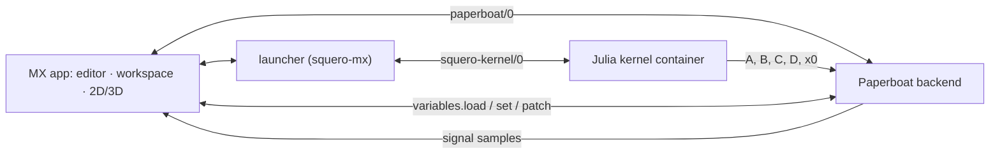

# Squero Studio MX

An open-source, **MATLAB-like workbench** for Paperboat. MX is the MATLAB side: scripts, matrices,
a live workspace, 2D graphs and 3D plots. Paperboat is the Simulink side: flow graphs,
`state_space`/`rhs` blocks, the in-house solvers, runs and signals.

MX is **not** a MATLAB compatibility product. It does not run `.m` files; it gives the feel
(1-based indexing, `A'*A`, `A\b`, `.*`, `end`, a command line, a workspace) on a Julia kernel.

## The four goals of this scaffold

1. **Share variables with Paperboat when MX is running.**
   - Paperboat's project variables are scalars, booleans and text. MX publishes its shareable
     scalars by name (`k` → Paperboat `k`) through `variables.set`; Paperboat's `variables.load`
     and `variables.patch` flow back into the workspace.
   - Matrices and vectors are **not** project variables. They travel as `Table`/`matrix` handles
     into `state_space` or matrix blocks.
   - When MX is not running or not attached, Paperboat runs unchanged. Sharing is additive.
2. **Use Paperboat's solver.**
   - MX computes `A, B, C, D, x0`; a `state_space` block derives from
     `paperboat::toolkit::Model`; the run's `solve::Solver` integrates.
   - MX never integrates locally. The Run dock offers `hello.run.solvers` (`rk4`, `rk45`, `rk2`,
     `euler`, `discrete`, `cvode`, `ida`) and `solve::Options`.
3. **2D graphing is the shared one.**
   - `@paperboat/shared/plot` (`Scope`, `Sparkline`; `Plot2D`/`Heatmap` follow) — the same
     component the Board uses.
4. **3D plotting is the Station renderer.**
   - `@paperboat/shared/station` (`SceneView`, `meshes`) draws a height field as a `mesh` entity:
     same three.js stage, camera, view cube, theme and field colours as the Station. No second
     3D stack.


## Architecture



The kernel is a separate process, normally a container (podman/docker/native), like `omc` in
Squero Studio OM. It ships a sysimage with LinearAlgebra, SparseArrays, Statistics,
ControlSystems and JSON3 — **no plotting and no simulation libraries**. Plotting and simulation
stay in-house.

Versioning follows Julia for the product (`1.11.5`) and tracks the frontend separately
(`0.1.0`), shown together in About and the console.

## Layout

```
src/
  App.tsx                 the shell: files, workspace, stage, shared variables, console
  chart/surface.ts        a height field as a Station mesh entity (the 3D chart)
  chart/samples.ts        demo workspace and run samples
  paperboat/link.ts       a minimal paperboat/0 client
  paperboat/variables.ts  the shared-variable contract (scalars by name; matrices to blocks)
  kernel/protocol.ts      squero-kernel/0 types (hello, eval, whos, get/set, snapshot)
  sim/stateSpace.ts       the A/B/C/D → Paperboat run contract
test/                     pure tests for the mesh and the variable merge
```

## Run

```sh
npm install
npm run dev        # http://localhost:3049
npm run typecheck
npm test
npm run build
```

`@paperboat/shared` is a sibling checkout (`file:../paperboat-shared`); install its dependencies
first if needed.

### Console

The bottom console is a real command line, not a log. It accepts:

```
help · whos · clear/clc · attach · detach
share <name> · unshare <name> · simulate/run · version
```

A bare variable name (`A`, `k`) inspects it. Anything else is queued for `squero-kernel/0` until
the Julia kernel is attached; the console says so instead of pretending to evaluate it. Arrow Up /
Arrow Down recall history.

## Status

Scaffold: the shell, the shared Station renderer as a 3D chart, the shared Scope, and the
variable/solver contracts. Next:

- `squero-julia-kernel` container + `squero-kernel/0` launcher.
- `state_space`/`rhs` toolkit blocks in Paperboat and the run dock.
- `Plot3D`/`Axes3D`/`ColorBar`/`Plot2D` in `@paperboat/shared/plot` (pb#312).
- `StationPanel`/`StationGraph` into `@paperboat/shared/station`.
- A `paperboat-client` package for the protocol/reducer.
