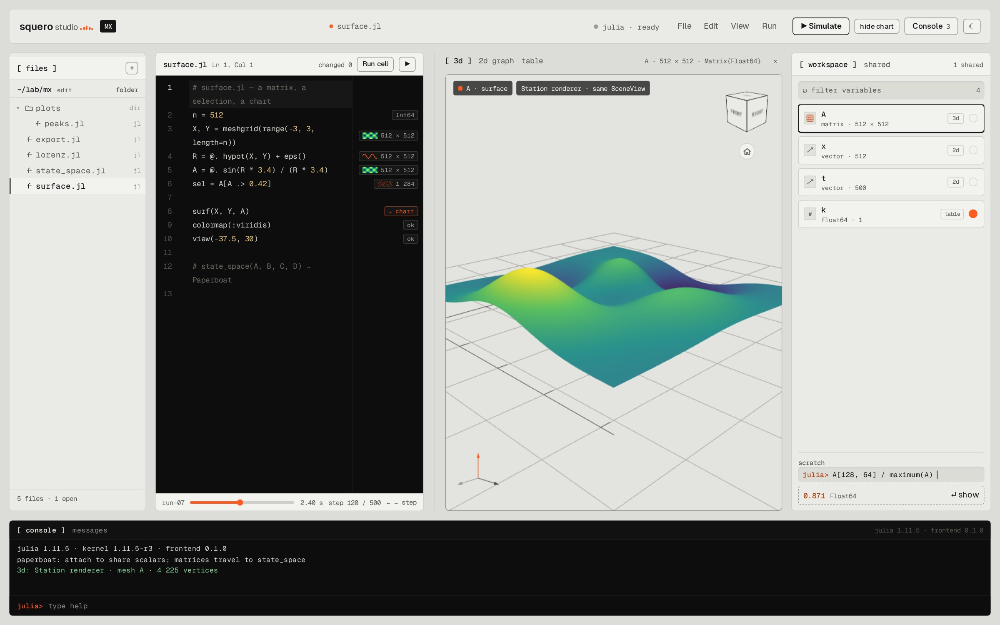
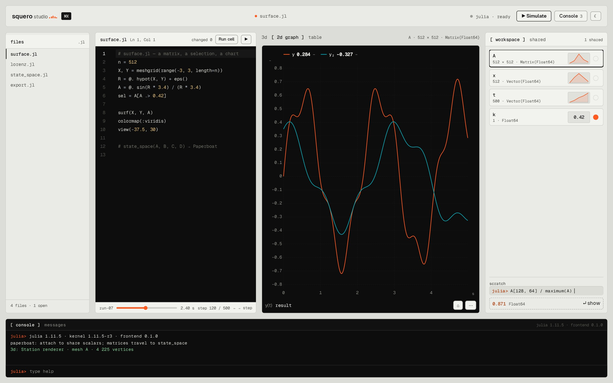
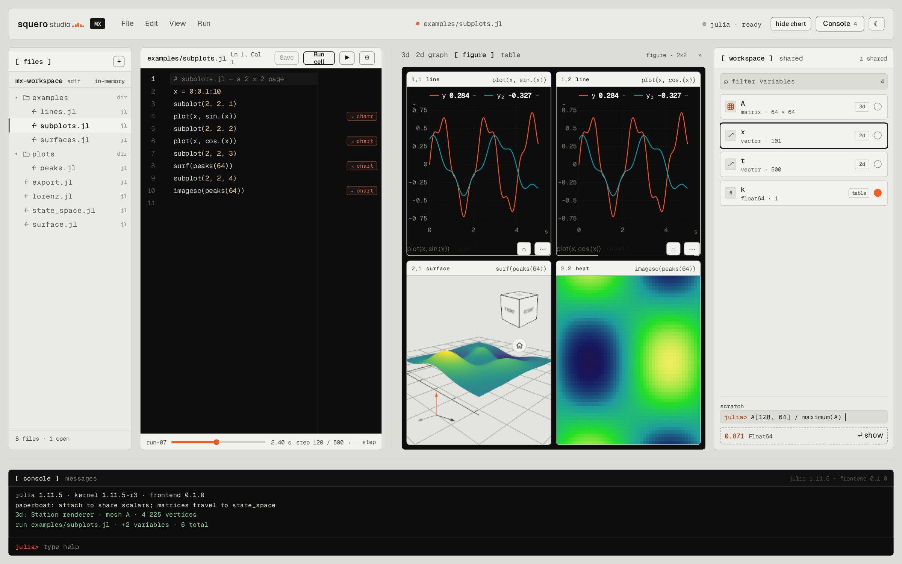
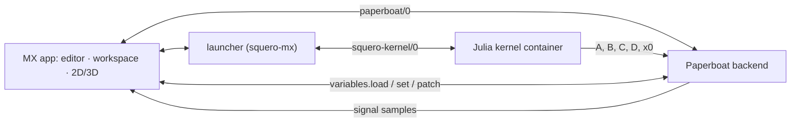

# Squero Studio MX

An open-source, **MATLAB-like workbench** for Paperboat. MX is the MATLAB side: scripts, matrices,
a live workspace, 2D graphs and 3D plots. Paperboat is the Simulink side: flow graphs,
`state_space`/`rhs` blocks, the in-house solvers, runs and signals.

MX is **not** a MATLAB compatibility product. It does not run `.m` files; it gives the feel
(1-based indexing, `A'*A`, `A\b`, `.*`, `end`, a command line, a workspace) on a Julia kernel.

## The four goals of this scaffold

1. **Share variables with Paperboat when MX is running.**
   - MX publishes its workspace as **live variables** (`variables.set` with `source: "mx"`):
     Paperboat lists them read-only beside its project variables and never saves them.
   - Matrices and vectors are **not** project variables. They are live `matrix` variables
     carrying their whole rows (`1 2; 3 4`); bind one to a Matrix block's `values` and a run
     sends the rows in place of the name.
   - When MX is not running or not attached, Paperboat runs unchanged. Sharing is additive.
2. **Paperboat owns simulation.**
   - MX does not start or integrate runs. It shares the scalars Paperboat needs and reads the
     signals Paperboat produces.
   - `state_space`/`rhs` blocks still use `paperboat::toolkit::Model` and the run's
     `solve::Solver`; that work stays in Paperboat.
3. **2D graphing is the shared one.**
   - `@paperboat/shared/plot` (`Scope`, `Sparkline`; `Plot2D`/`Heatmap` follow) — the same
     component the Board uses.
4. **3D plotting is the Station renderer.**
   - `@paperboat/shared/station` (`SceneView`, `meshes`) draws a height field as a `mesh` entity:
     same three.js stage, camera, view cube, theme and field colours as the Station. No second
     3D stack.







## Architecture



The kernel is a separate process, normally a container (podman/docker/native), like `omc` in
Squero Studio OM. It ships a sysimage with LinearAlgebra, SparseArrays, Statistics,
ControlSystems and JSON3 — **no plotting and no simulation libraries**. Plotting and simulation
stay in-house.

Versioning follows Julia for the product (`1.11.6`) and tracks the frontend separately
(`0.1.0`), shown together in About and the console.

## Layout

```
src/
  App.tsx                 the shell: files, workspace, stage, kernel panel, console
  chart/surface.ts        the peaks surface + the origin axes as Station entities
  chart/samples.ts        demo workspaces and run samples
  editor/CodeEditor.tsx   CodeMirror 6, Julia language, completions, settings, answer tokens
  editor/gitGutter.ts     the git gutter: lines added/changed/deleted since HEAD
  editor/julia.ts         the Julia stream parser (macros, types, symbols, interpolation)
  editor/unicode.ts       the `\pi` + Tab symbol map shared by the editor and console
  files/FilePanel.tsx     the MX mutations around the shared FileTree
  files/storage.ts        real folders through the File System Access API
  julia/JuliaPanel.tsx    juliaup, the workspace packages and the General registry browser
  julia/client.ts         `/__mx/julia` status, package and registry calls
  shell/KernelPanel.tsx   the centred kernel dialog opened from the bar
  plot/figure.ts          the figure model: tiles, series, surfaces
  plot/spec.ts            chart/optimization specs → the figure model (no parser)
  plot/FigureView.tsx     a figure page: Scope, SceneView, heat and scatter tiles
  kernel/client.ts        the squero-kernel/0 socket (one session, requests by id)
  kernel/localEval.ts     the scratch-line evaluator before a kernel is attached
  kernel/protocol.ts      squero-kernel/0 types (hello, eval, whos, get/set, snapshot)
  paperboat/link.ts       one paperboat/0 socket
  paperboat/hub.ts        every discovered backend, broadcast to as one
  paperboat/discovery.ts  the launcher's `paperboat list --json` view
  paperboat/variables.ts  the shared-variable contract (scalars by name; matrices to blocks)
  sim/stateSpace.ts       the A/B/C/D → Paperboat run contract
  workspace/mat.ts        a MAT v4 writer for the numeric workspace
server/                   workspace, kernel, backends, optimize and Julia/registry bridges
test/                     mesh, variables, MAT, Julia registry symbols and evaluator tests
```

## Run

```sh
npm install
npm run dev        # http://localhost:3049
npm run typecheck
npm test
npm run build
```

`@paperboat/shared` is a sibling checkout (`file:../paperboat-shared`); install its dependencies
first if needed.

### Editor

The script surface is CodeMirror 6 (`src/editor/CodeEditor.tsx`): the local Julia stream parser
(`editor/julia.ts`), line numbers, history, rectangular selection, bracket matching/closing, lint
gutter, and a light/dark palette that also themes the answer gutter and the completion popup. The
parser separates macros, symbols, type annotations and types, standard calls, definitions,
escapes and string interpolation. Completions include the live workspace, functions, keywords,
builtins, snippets and LaTeX-style symbols; the popup uses mono kind tags (`fn`, `var`, `kw`,
`snp`, `λ`) and marks the chosen row with a line, not a fill.

The sliders key opens settings for theme (`ui` follows the main UI, or light/dark), font
(Geist/System/Serif), size, line height, tab size, wrapping, autocomplete, brackets and lint; they
persist in `localStorage`. `\pi` then Tab becomes π in both the editor and the console.
A small habit linter flags `%` comments (Julia uses `#`); the gutter is the seam for kernel
diagnostics and an LSP later.

`Ctrl/Cmd+Enter` runs the current cell (a `#%%` section, or the selection; the whole file when
there is no cell). `Shift+Enter` runs the selection, or the current line. Both also parse a
`subplot` figure from what ran.

### Figures and subplot

`subplot(m, n, p)` followed by `plot`, `surf`, `mesh`, `imagesc` or `scatter` adds a **figure**
to the Figures browser, with a grid of shared tiles: line tiles are the Scope, surface tiles the
Station SceneView, heat/scatter small canvases. A run adds one figure, newest first, with its
script, time and plot count; click a row to show it, `×` closes it. Clicking a `→ chart` token
in the editor shows the matching figure and outlines its tile. `Edit ▸ Clear figures` empties
the browser.

3D surfaces draw one origin frame through (0, 0, 0) in muted grey: x, y and z run in both
directions past the data, with the ground grid on y = 0. A bottom-left triad and the top-right
wireframe view cube carry the live x/y/z direction; the cube turns with the camera and its axes
sit on one vertex. The optimization cost plot uses the same in-scene frame, sized to the decision
box, and draws the objective's height to that box (lowest value on the floor, highest at 0.6 of its
width), so a small cost over a large box is not flat; the camera fits the whole surface and the
returned optimum is a red sphere with a drop line to its footprint.

The browser supports Ctrl/Cmd-click to add/remove a figure and Shift-click for a range; `Delete`
closes the selected figures (Ctrl/Cmd+A selects all). Export the selection, or the shown figure,
as **PNG, SVG, EPS or PDF**; several figures come as one `mx-figures.zip`. PNG is a 2× capture of
the rendered page; the vector formats embed the same capture.

The repo's `examples/` folder is on disk and is copied to the default workspace; try
`subplots.jl`, `subplot-scatter.jl`, `lines.jl` and `surfaces.jl`.

### Workspace

Like MATLAB's, the workspace is **the session**, not the open file: a run adds/overwrites its
variables, other variables stay until `clear`, and switching scripts does not change it. `clear`
empties it, `clear x` removes one binding and `clc` only clears the console. In a script,
`clear()` takes effect between statements, so what the script defines after it stays
(`clear.jl` leaves `z`, `a`, `f` and `t`). Functions are listed too (`ƒ`) but stay in MX. The filter searches
name, shape and type. Each card shows the value on the right (a scalar, or an array's first
entries); the dot is the automatic broadcast to Paperboat.

`File ▸ Export workspace (.mat)…` writes a MAT v4 file (double matrices/vectors/scalars) that
MATLAB and Octave load directly.

Every variable is **broadcast by default** to every running Paperboat backend: the launcher
discovers them with `paperboat list --json` (`/__mx/backends`), MX connects to each one and sends
its whole workspace with `variables.set` when it changes. There is no URL to pick and no shared
page; the two conventional local ports are tried when the CLI is not installed. Scalars are
numbers. Arrays are `matrix` variables: MX fetches each one whole from the kernel (`get`, a
binary Float64 frame) after a run and sends its rows, a vector as a column (`1; 2; 3`). An array
of more than 4096 values is sent without a value and with a note (shape, count, the limit, and
to share a slice such as `B[1:10, 1:10]`); a Paperboat run that uses it stops with that note.
A preview is never sent as if it were the matrix.

### Files and menus

The Files rail is `@paperboat/shared/files` — the same tree as Squero Studio OM. It supports
folders, selection, new file/folder, rename, duplicate, delete, copy path and drag-to-move. `.jl`
files carry the Julia dots instead of a generic glyph. Both side panels collapse to a standing
tab with the chevron in their header, like Lookout's drawers; `View` has matching toggles.

The workspace is the real folder `~/Documents/paperboat/squero-studio/mx`; there is no
in-memory copy. The dev/preview server exposes it at `/__mx/workspace` (set `MX_WORKSPACE` to
point elsewhere), so the app opens the files on start with no folder-permission prompt and
create/rename/move/delete/save write straight through. `npm run build` served as static files
has no endpoint; there the folder key (or `File ▸ Open workspace folder…`) uses the browser
picker, which is also how another folder is opened. The chosen handle is remembered in
IndexedDB and restored when its permission is still granted. `Save` / `Ctrl+S` writes the current
file; an edited file shows `•`. Double-click the project title in the top bar to rename it in
place. The topbar menus also expose find, clear, chart visibility and run.

When the workspace is inside a git repository, `/__mx/workspace/git` returns HEAD's copy of each
tracked `.jl` and the ones HEAD lacks. The rail marks files `M` (differs from HEAD, unsaved edits
included) or `U` (untracked), and the editor's git gutter diffs the live buffer against HEAD: a
signal bar for added lines, a half-tone bar for changed ones, a wedge where lines were deleted.
It reloads when files come or go and when the window regains focus (after a commit elsewhere).
Read-only by design: stage and commit in a terminal or another client. A folder opened through the
browser picker has no git.

### About and dismissal

`About` opens the same dialog as OM: the rippling wordmark, the frontend, Julia, kernel, Paperboat
and license facts, and the credits. Floating surfaces follow one rule (shared `useDismiss`): a
press outside or Escape closes them, the trigger does not immediately reopen them, and focus
returns to where it was — menus, the About dialog and the editor settings all use it.

### Kernel panel and julia up

The kernel chip in the bar is a button (`julia · starting` until the first probe answers, then
`julia <version> · kernel`, or `julia · unavailable`): it opens a centred panel with the running Julia/kernel
versions, the **julia up** view, and the **registry** view. `julia` is the version juliaup has
selected; *Update* runs `juliaup update`, the environment lists the workspace project's direct
packages and lets you add, remove, update or reload them.

The registry view opens on ten popular packages and searches the **General** registry as you
type (`Registry.toml` from the Julia depot's `General.tar.gz`, or the GitHub archive cached in
`~/.cache/squero-mx`). A result opens its `Package.toml`, version history and dependencies, with
the description and stars from GitHub when available; **Add** on the row or in the detail card
installs it into the workspace project, with no separate `pkg` field to fill in. Package work
runs in the same native Julia or kernel container the scripts use, with the workspace mounted so
`Project.toml`, `Manifest.toml` and the workspace depot persist. The kernel puts that project on
`JULIA_LOAD_PATH`, so a package added here is available to a script.

### Launcher, kernel and the app manifest

`npm start` (or `bin/squero-mx`) serves `dist/` with the same default workspace and kernel bridge
the dev server uses. `paperboat pkg install squero-studio-mx` installs it from `apps.toml`,
`paperboat start squero-studio-mx` runs it on port 59301, and `paperboat stop squero-studio-mx`
stops it — the same flow as Squero Studio OM. The manifest also installs
`squero-julia-kernel`, which builds the pinned image.

The kernel is `squero-julia-kernel:1.11.6-r1`, a Julia container with `--network=none` that speaks
`squero-kernel/0` on stdio; the launcher bridges it to `/__mx/kernel` (one process per WebSocket).
`SQUERO_JULIA=native` runs a sibling `squero-julia-kernel` checkout instead. `bin/doctor` in that
repo reports native/container, Julia, the image and a `hello`. Plotting and solving stay out of the
kernel: charts are shared Paperboat components and solvers live in Paperboat.

### Console

The bottom console is a real Julia REPL and the script stdout sink. Anything that is not a UI
command is evaluated in the kernel session and prints its value as Julia's REPL does (a matrix
keeps its columns) or its Julia error in red; scripts run from the editor print their stdout here
too.

```
help · whos · clear [name] · clc · attach · detach
run · version
```

`clear` resets the kernel session and the workspace; `clear x` removes one binding from the
workspace; `clc` clears the console. `\pi` then Tab becomes π. Arrow Up/Arrow Down recall history.
The scratch line under the workspace still evaluates simple expressions locally until a kernel is
attached.

Optimization specs go to the launcher's `/__mx/optimize`, which runs
`paperboat optimize <problem> --json --grid 41` (the checkout's CLI, or `$PAPERBOAT_BIN`; it runs
asynchronously, so a long solve never stalls the launcher): the same readers, OSQP/Ipopt solver and
`options.display` trace the Paperboat blocks use. An NLP needs a Paperboat built with Ipopt. The app binds `x_opt`/`f_opt` and draws the
optimum on the objective surface.

## Status

The kernel, the spec path and the optimization bridge are in place. Next:

- `state_space`/`rhs` toolkit blocks in Paperboat and the run dock.
- `Plot3D`/`Axes3D`/`ColorBar`/`Plot2D` in `@paperboat/shared/plot` (pb#312).
- The Julia backend host (`paperboat new --julia`, pb#323) is in the engine; MX itself reads
  SqueroBase from the `squero-mx-base` checkout, mounted read-only into the kernel.
- `StationPanel`/`StationGraph` into `@paperboat/shared/station`.
- A `paperboat-client` package for the protocol/reducer.
