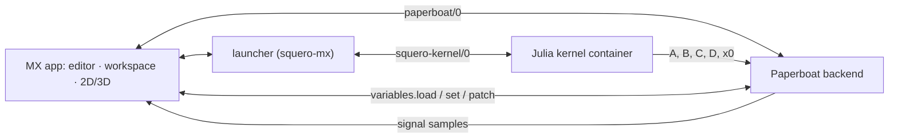

# Squero Studio MX

An open-source, **MATLAB-like workbench** for Paperboat. MX is the MATLAB side: scripts, matrices,
a live workspace, 2D graphs and 3D plots. Paperboat is the Simulink side: flow graphs,
`state_space`/`rhs` blocks, the in-house solvers, runs and signals.

MX is **not** a MATLAB compatibility product. It does not run `.m` files; it gives the feel
(1-based indexing, `A'*A`, `A\b`, `.*`, `end`, a command line, a workspace) on a Julia kernel.

## The four goals of this scaffold

1. **Share variables with Paperboat when MX is running.**
   - Paperboat's project variables are scalars, booleans and text. MX publishes its shareable
     scalars by name (`k` → Paperboat `k`) through `variables.set`; Paperboat's `variables.load`
     and `variables.patch` flow back into the workspace.
   - Matrices and vectors are **not** project variables. They travel as `Table`/`matrix` handles
     into `state_space` or matrix blocks.
   - When MX is not running or not attached, Paperboat runs unchanged. Sharing is additive.
2. **Paperboat owns simulation.**
   - MX does not start or integrate runs. It shares the scalars Paperboat needs and reads the
     signals Paperboat produces.
   - `state_space`/`rhs` blocks still use `paperboat::toolkit::Model` and the run's
     `solve::Solver`; that work stays in Paperboat.
3. **2D graphing is the shared one.**
   - `@paperboat/shared/plot` (`Scope`, `Sparkline`; `Plot2D`/`Heatmap` follow) — the same
     component the Board uses.
4. **3D plotting is the Station renderer.**
   - `@paperboat/shared/station` (`SceneView`, `meshes`) draws a height field as a `mesh` entity:
     same three.js stage, camera, view cube, theme and field colours as the Station. No second
     3D stack.


## Architecture



The kernel is a separate process, normally a container (podman/docker/native), like `omc` in
Squero Studio OM. It ships a sysimage with LinearAlgebra, SparseArrays, Statistics,
ControlSystems and JSON3 — **no plotting and no simulation libraries**. Plotting and simulation
stay in-house.

Versioning follows Julia for the product (`1.11.6`) and tracks the frontend separately
(`0.1.0`), shown together in About and the console.

## Layout

```
src/
  App.tsx                 the shell: files, workspace, stage, shared variables, console
  chart/surface.ts        the peaks surface + axes as Station mesh/line entities
  chart/samples.ts        demo workspaces and run samples
  editor/CodeEditor.tsx   CodeMirror 6, Julia mode, completions, settings, answer tokens
  files/FilePanel.tsx     the MX mutations around the shared FileTree
  files/storage.ts        real folders through the File System Access API
  plot/figure.ts          the figure model: tiles, series, surfaces
  plot/spec.ts            chart/optimization specs → the figure model (no parser)
  plot/FigureView.tsx     a figure page: Scope, SceneView, heat and scatter tiles
  kernel/client.ts        the squero-kernel/0 socket (one session, requests by id)
  kernel/localEval.ts     the scratch-line evaluator before a kernel is attached
  kernel/protocol.ts      squero-kernel/0 types (hello, eval, whos, get/set, snapshot)
  paperboat/link.ts       a minimal paperboat/0 client
  paperboat/variables.ts  the shared-variable contract (scalars by name; matrices to blocks)
  sim/stateSpace.ts       the A/B/C/D → Paperboat run contract
  workspace/mat.ts        a MAT v4 writer for the numeric workspace
test/                     mesh, variables, MAT and local-evaluator tests
```

## Run

```sh
npm install
npm run dev        # http://localhost:3049
npm run typecheck
npm test
npm run build
```

`@paperboat/shared` is a sibling checkout (`file:../paperboat-shared`); install its dependencies
first if needed.

### Editor

The script surface is CodeMirror 6 (`src/editor/CodeEditor.tsx`): Julia stream mode, line
numbers, history, rectangular selection, bracket matching/closing, lint gutter, and the app's
token colours. Completions include Julia keywords, builtins, snippets and the live workspace
variables. The gear opens settings for dark/light theme, font (Geist/System/Serif), size, line
height, tab size, wrapping, autocomplete, brackets and lint; they persist in `localStorage`.
A small habit linter flags `%` comments (Julia uses `#`); the gutter is the seam for kernel
diagnostics and an LSP later. The same wrapper takes
`@codemirror/legacy-modes/mode/modelica`, so Squero OM can reuse it once it moves to
`@paperboat/editor`.

`Ctrl/Cmd+Enter` runs the current cell (a `#%%` section, or the selection; the whole file when
there is no cell). `Shift+Enter` runs the selection, or the current line. Both also parse a
`subplot` figure from what ran.

### Figures and subplot

`subplot(m, n, p)` followed by `plot`, `surf`, `mesh`, `imagesc` or `scatter` adds a **figure**
to the Figures browser, with a grid of shared tiles: line tiles are the Scope, surface tiles the
Station SceneView, heat/scatter small canvases. A run adds one figure, newest first, with its
script, time and plot count; click a row to show it, `×` to close it. Clicking a `→ chart` token
in the editor shows the matching figure and outlines its tile.

The browser supports Ctrl/Cmd-click to add/remove a figure and Shift-click for a range; `Delete`
closes the selected figures (Ctrl/Cmd+A selects all). Export the selection, or the shown figure,
as **PNG, SVG, EPS or PDF**; several figures come as one `mx-figures.zip`. PNG is a 2× capture of
the rendered page; the vector formats embed the same capture.

The repo's `examples/` folder is on disk and is copied to the default workspace; try
`subplots.jl`, `subplot-scatter.jl`, `lines.jl` and `surfaces.jl`.

### Workspace

Like MATLAB's, the workspace is **the session**, not the open file: a run adds/overwrites its
variables, other variables stay until `clear`, and switching scripts does not change it. `clear`
empties it, `clear x` removes one binding and `clc` only clears the console. The filter searches
name, shape and type. Each card shows the value on the right (a scalar, or an array's first
entries); the dot is the automatic broadcast to Paperboat.

`File ▸ Export workspace (.mat)…` writes a MAT v4 file (double matrices/vectors/scalars) that
MATLAB and Octave load directly.

Every variable is **broadcast by default**: MX connects to `ws://localhost:8780` automatically,
loads Paperboat's variables and sends its whole workspace back with `variables.set` when it
changes. Scalars are numbers; arrays are text (JSON when small, a typed descriptor otherwise),
while their data still travels to `state_space`/matrix blocks. One MX instance is enough; there
is no per-instance name.

### Files and menus

The Files rail is `@paperboat/shared/files` — the same tree as Squero Studio OM. It supports
folders, selection, new file/folder, rename, duplicate, delete, copy path and drag-to-move. `.jl`
files carry the Julia dots instead of a generic glyph. Both side panels collapse to a standing
tab with the chevron in their header, like Lookout's drawers; `View` has matching toggles.

The workspace is the real folder `~/Documents/paperboat/squero-studio/mx`; there is no
in-memory copy. The dev/preview server exposes it at `/__mx/workspace` (set `MX_WORKSPACE` to
point elsewhere), so the app opens the files on start with no folder-permission prompt and
create/rename/move/delete/save write straight through. `npm run build` served as static files
has no endpoint; there the folder key (or `File ▸ Open workspace folder…`) uses the browser
picker, which is also how another folder is opened. The chosen handle is remembered in
IndexedDB and restored when its permission is still granted. `Save` / `Ctrl+S` writes the current
file; an edited file shows `•`. Double-click the project title in the top bar to rename it in
place. The topbar menus also expose find, clear, chart visibility and run.

### About and dismissal

`About` opens the same dialog as OM: the rippling wordmark, the frontend, Julia, kernel, Paperboat
and license facts, and the credits. Floating surfaces follow one rule (shared `useDismiss`): a
press outside or Escape closes them, the trigger does not immediately reopen them, and focus
returns to where it was — menus, the About dialog and the editor settings all use it.

### Launcher, kernel and the app manifest

`npm start` (or `bin/squero-mx`) serves `dist/` with the same default workspace and kernel bridge
the dev server uses. `paperboat pkg install squero-studio-mx` installs it from `apps.toml`,
`paperboat start squero-studio-mx` runs it on port 59301, and `paperboat stop squero-studio-mx`
stops it — the same flow as Squero Studio OM. The manifest also installs
`squero-julia-kernel`, which builds the pinned image.

The kernel is `squero-julia-kernel:1.11.6-r1`, a Julia container with `--network=none` that speaks
`squero-kernel/0` on stdio; the launcher bridges it to `/__mx/kernel` (one process per WebSocket).
`SQUERO_JULIA=native` runs a sibling `squero-julia-kernel` checkout instead. `bin/doctor` in that
repo reports native/container, Julia, the image and a `hello`. Plotting and solving stay out of the
kernel: charts are shared Paperboat components and solvers live in Paperboat.

### Console

The bottom console is a real command line, not a log. It accepts:

```
help · whos · clear [name] · clc · attach · detach
share <name> · unshare <name> · simulate/run · version
```

Scripts run in the kernel: `squero-kernel/0` evaluates them, SqueroBase records the chart
and optimization specs, and the app renders those specs. A run has no local parser or solver.
The scratch line still evaluates locally until a kernel is attached (then it uses the same
session); short-form functions, numbers, vectors, matrices, ranges, common math functions and
the MATLAB-style builders are supported there. Arrow Up/Arrow Down recall history.

Optimization specs go to the launcher's `/__mx/optimize`, which runs
`paperboat optimize <problem> --json --grid 41`: the same readers, OSQP/Ipopt solver and
`options.display` trace the Paperboat blocks use. The app binds `x_opt`/`f_opt` and draws the
optimum on the objective surface.

## Status

The kernel, the spec path and the optimization bridge are in place. Next:

- `state_space`/`rhs` toolkit blocks in Paperboat and the run dock.
- `Plot3D`/`Axes3D`/`ColorBar`/`Plot2D` in `@paperboat/shared/plot` (pb#312).
- The Julia backend host (`paperboat new --julia`, pb#323) is in the engine; MX itself reads
  SqueroBase from the `squero-mx-base` checkout, mounted read-only into the kernel.
- `StationPanel`/`StationGraph` into `@paperboat/shared/station`.
- A `paperboat-client` package for the protocol/reducer.
