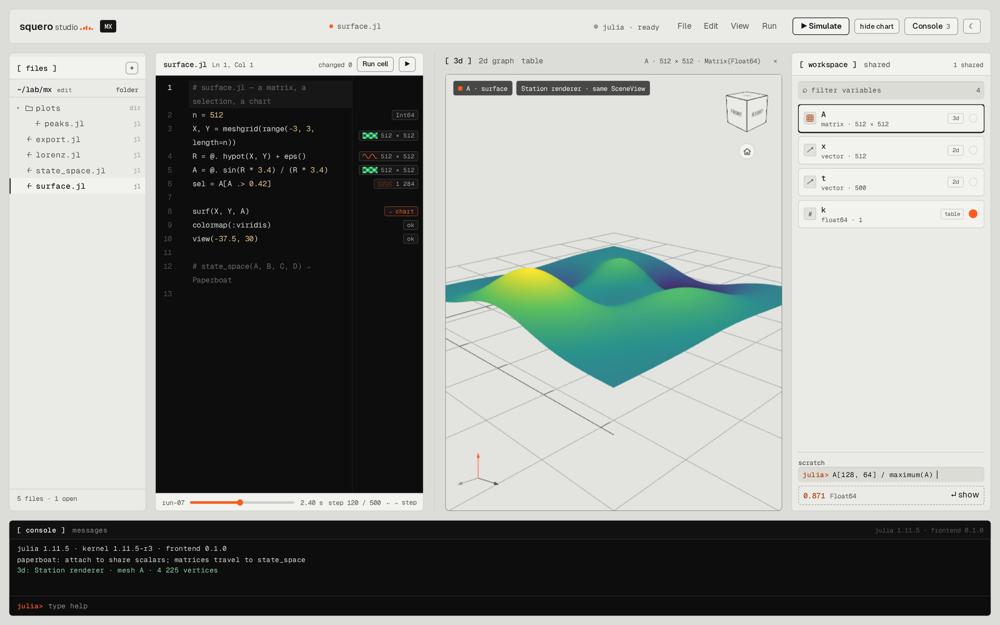
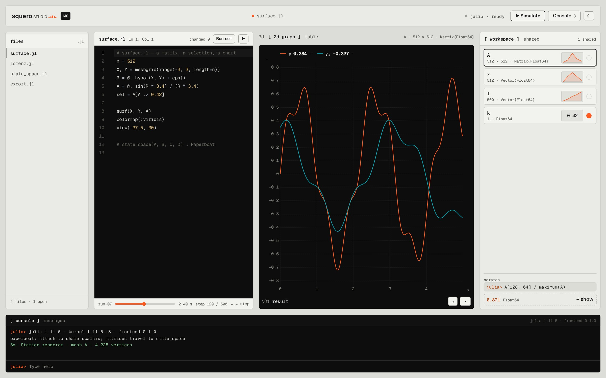
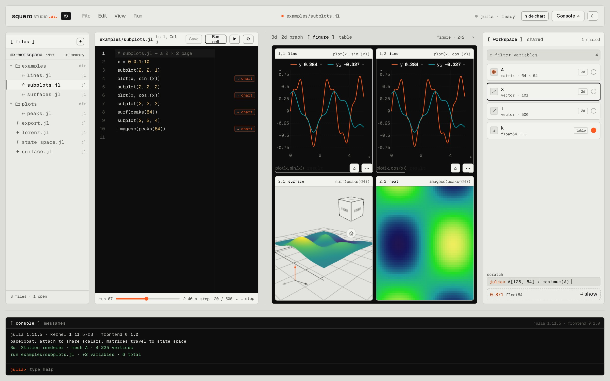
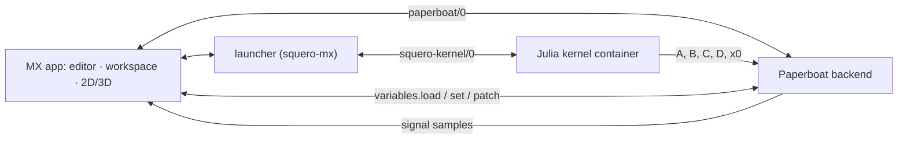

# Squero Studio MX

**Docs:** <https://paperboatlab.github.io/apps/squero-studio-mx/>

An open-source, **MATLAB-like workbench** for Paperboat. MX is the MATLAB side: scripts, matrices,
a live workspace, 2D graphs and 3D plots. Paperboat is the Simulink side: flow graphs,
`state_space`/`rhs` blocks, the in-house solvers, runs and signals.

MX is **not** a MATLAB compatibility product. It does not run `.m` files; it gives the feel
(1-based indexing, `A'*A`, `A\b`, `.*`, `end`, a command line, a workspace) on a Julia kernel.

## The four goals of this scaffold

1. **Share variables with Paperboat when MX is running.**
   - MX publishes its workspace as **live variables** (`variables.set` with `source: "mx"`):
     Paperboat lists them read-only beside its project variables and never saves them.
   - Matrices and vectors are **not** project variables. They are live `matrix` variables
     carrying their whole rows (`1 2; 3 4`); bind one to a Matrix block's `values` and a run
     sends the rows in place of the name.
   - When MX is not running or not attached, Paperboat runs unchanged. Sharing is additive.
2. **Paperboat owns simulation.**
   - MX does not start or integrate runs. It shares the scalars Paperboat needs and reads the
     signals Paperboat produces.
   - `state_space`/`rhs` blocks still use `paperboat::toolkit::Model` and the run's
     `solve::Solver`; that work stays in Paperboat.
3. **2D graphing is the shared one.**
   - `@paperboat/shared/plot` (`Scope`, `Sparkline`; `Plot2D`/`Heatmap` follow) — the same
     component the Board uses.
4. **3D plotting is the Station renderer.**
   - `@paperboat/shared/station` (`SceneView`, `meshes`) draws a height field as a `mesh` entity:
     same three.js stage, camera, view cube, theme and field colours as the Station. No second
     3D stack.







## Architecture



The kernel is a separate process, normally a container (podman/docker/native), like `omc` in
Squero Studio OM. It ships a sysimage with LinearAlgebra, SparseArrays, Statistics,
ControlSystems and JSON3 — **no plotting and no simulation libraries**. Plotting and simulation
stay in-house.

Releases follow frontend semver (`0.1.0-alpha.9`, tag `v0.1.0-alpha.9`) so `paperboat pkg`
tracks UI releases directly; the Julia runtime (`1.11.6`) and pinned kernel image
(`1.11.6-r3`) move independently and appear beside it in About, the console banner, and
`apps.toml`.

## Layout

```
src/
  App.tsx                 the shell: files, workspace, stage, kernel panel, console
  chart/surface.ts        the peaks surface + the origin axes as Station entities
  chart/samples.ts        demo workspaces and run samples
  editor/CodeEditor.tsx   Julia on the shared editor: language, completions, lint, keys, answer tokens
  editor/julia.ts         the Julia stream parser (macros, types, symbols, interpolation)
  editor/unicode.ts       the `\pi` + Tab symbol map shared by the editor and console
  files/FilePanel.tsx     the MX mutations around the shared FileTree
  files/storage.ts        real folders through the File System Access API
  julia/JuliaPanel.tsx    juliaup, the workspace packages and the General registry browser
  julia/client.ts         `/__mx/julia` status, package and registry calls
  shell/KernelPanel.tsx   the centred kernel dialog opened from the bar
  shell/help.ts           MX's side of the shared Help window: guides and Julia docstrings (F1, ?name)
  workspace/importData.ts import: .csv .tsv .txt .dat .json .mat (v4–v7) .xlsx, parsed in the browser
  workspace/ImportDialog.tsx  the import preview: a matrix or a vector per column
  workspace/VariableEditor.tsx  a workspace array as an editable grid (double-click, openvar)
  plot/figure.ts          the figure model: tiles, series, surfaces
  plot/spec.ts            chart/optimization specs → the figure model (no parser)
  plot/FigureView.tsx     a figure page: Scope, SceneView, heat and scatter tiles
  kernel/client.ts        the squero-kernel/0 socket (one session, requests by id)
  kernel/localEval.ts     the scratch-line evaluator before a kernel is attached
  kernel/protocol.ts      squero-kernel/0 types (hello, eval, whos, get/set, snapshot)
  paperboat/link.ts       one paperboat/0 socket
  paperboat/hub.ts        every discovered backend, broadcast to as one
  paperboat/discovery.ts  the launcher's `paperboat list --json` view
  paperboat/variables.ts  the shared-variable contract (scalars by name; matrices to blocks)
  sim/stateSpace.ts       the A/B/C/D → Paperboat run contract
  workspace/mat.ts        a MAT v4 writer for the numeric workspace
server/                   workspace, kernel, backends, optimize and Julia/registry bridges
test/                     mesh, variables, MAT, Julia registry symbols and evaluator tests
```

## Run

```sh
npm install
npm run dev        # http://localhost:3049
npm run typecheck
npm test
npm run build
```

`@paperboat/shared` is a sibling checkout (`file:../paperboat-shared`); install its dependencies
first if needed.

How to use it (the editor, console, workspace, data import, figures, files, the kernel panel and
the launcher) is in the manual: <https://paperboatlab.github.io/apps/squero-studio-mx/>, also in
the app's Help window (F1). Its sources are [`docs/`](docs/) (reStructuredText); the org site
builds them with Paperboat's `docs/site/build.py`.

## Status

The kernel, debugger, spec path, figure run grouping, `state_space`/`rhs` simulation dock,
and the optimization bridge are in place. Next:

- `Plot3D`/`Axes3D`/`ColorBar`/`Plot2D` enhancements in `@paperboat/shared/plot` (pb#312).
- The Julia backend host (`paperboat new --julia`, pb#323) is in the engine; MX itself reads
  SqueroBase from the `squero-mx-base` checkout, mounted read-only into the kernel.
- `StationPanel`/`StationGraph` into `@paperboat/shared/station`.
- A `paperboat-client` package for the protocol/reducer.
