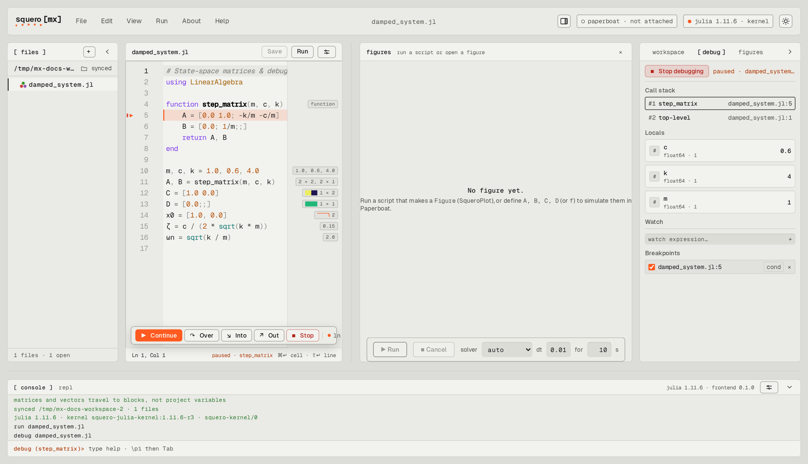

Editor and debugger
===================

The script editor shares its core with Squero Studio OM and adds Julia-specific syntax
highlighting, inline answer badges, completions, cell execution, and a visual debugger.

Inline answers and completions
------------------------------

- **Inline answer badges** appear to the right of evaluated lines so you can see types, shapes
  (``60 × 60``), scalar results, and ``→ figure`` / ``→ optimize`` jump badges without cluttering
  the console. Clicking ``→ figure`` switches the stage to the figure created on that line.
- **Autocomplete** offers live workspace variables (``var``), Julia functions (``fn``), keywords
  (``kw``), snippets (``snp``), and LaTeX math symbols (``λ``).
- **Unicode symbols**: type a LaTeX token such as ``\pi``, ``\zeta``, or ``\omega`` and press
  :kbd:`Tab` to turn it into ``π``, ``ζ``, or ``ω`` in both the editor and the console.
- **Habit linter**: a gutter lint rule flags MATLAB-style ``%`` comments (Julia comments start with
  ``#``).

Cells, lines, and read-only examples
------------------------------------

- Divide a script into sections with ``#%%`` comments and press ``Ctrl/Cmd+Enter`` to run only the
  cell containing the cursor.
- Press ``Shift+Enter`` to run only the current line or selected text.
- When you open a shipped tutorial script (via ``open_example(...)``), the editor displays a
  ``read-only`` badge so the built-in curriculum stays intact. Click **Copy to workspace** in the
  editor header whenever you want an editable copy in your workspace folder.

Visual debugger
---------------

Switch the right pane to **debug** (or use **View ▸ Debug tab**) to step through Julia scripts and
functions:

1. **Set breakpoints**: click the line-number gutter next to any executable line to toggle a
   breakpoint. In the **Breakpoints** list on the right, click ``cond`` to attach a Julia boolean
   condition or use the checkbox to disable a breakpoint temporarily.
2. **Start debugging**: click **Start debugging** in the **debug** tab (or **Run ▸ Start
   debugging**).
3. **Control execution**: when paused on a line, a debugger dock appears above the editor's run
   strip with:

   - **Continue** (:kbd:`F5`)
   - **Step Over** (:kbd:`F10`)
   - **Step Into** (:kbd:`F11`)
   - **Step Out** (:kbd:`Shift+F11`)
   - **Stop** (:kbd:`Shift+F5`)

4. **Inspect state**: while paused, **Call stack** lets you click between frames, **Locals** shows
   each variable in the selected frame, **Watch** evaluates custom Julia expressions on every stop,
   and the console prompt changes to ``debug (<frame>)>`` so you can run expressions in that scope.

Editor settings and themes
--------------------------

Click the sliders button in the editor header to configure theme (``ui`` follows light/dark mode,
or pick ``paper``, ``ink``, ``sepia``, ``harbor``, or ``contrast``), font family, font size, line
height, tab size, word wrap, autocomplete, bracket closing, and linting.

Settings are saved in ``squero.toml`` (shared with Squero Studio OM) inside
``~/.config/paperboat/`` (``$XDG_CONFIG_HOME``) on Linux/macOS or ``%APPDATA%\paperboat\`` on
Windows. Custom palettes can be added under ``[themes.<name>]`` in that file.
