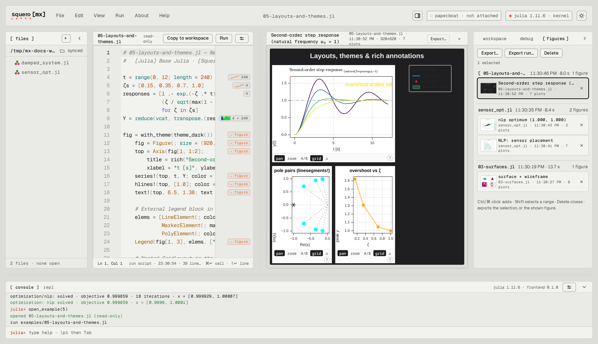

Figures and plotting
====================

Squero Studio MX preloads **SqueroPlot.jl** into every kernel session, giving you a Makie-style
2D and 3D plotting API (`Figure`, `Axis`, `Axis3`, `GridLayout`, `lines!`, `surface!`, `heatmap!`,
`contourf!`, `barplot!`, `with_theme`, …) plus a quick MATLAB-like ``subplot(m, n, p)`` form.

Interactive 2D and 3D stage
---------------------------

The center **figures** stage renders each figure interactively:

- **2D axes**: drag to pan, scroll to zoom, toggle **grid** or **A/B** view controls in the tile
  footer, and reset limits with a double-click.
- **3D surfaces (``Axis3``)**: drag to orbit, scroll to zoom, snap to orthogonal planes with the
  **Iso** button or top-right wireframe **view cube**, and toggle the ground **Grid**.
- **Optimization surfaces**: when ``SqueroBase.optimize`` solves a 2D problem, MX automatically
  adds an interactive 3D objective surface showing the returned optimum as a red sphere with a
  drop line to the floor.

Jump back to source with editor badges
~~~~~~~~~~~~~~~~~~~~~~~~~~~~~~~~~~~~~~

Lines in the editor that create or add to a figure show a ``→ figure`` badge. Clicking that badge
brings the matching figure into the center stage.

Figures browser and export
--------------------------

Switch the right pane to **figures** (or **View ▸ Figures**) to browse every figure created in
the session, grouped by run newest first:

- **Multi-select**: click a run header to select all figures in that run, ``Ctrl/Cmd``-click to
  toggle individual figures, ``Shift``-click to select a range, or press ``Delete`` to close
  selected figures.
- **Export**: click **Export…** (in the stage or browser) for the selected figure(s), or
  **Export run…** to export the latest version of every figure in the selected run.
- **Formats**: **PNG** (2× rendered capture), **SVG**, **EPS**, **PDF**, or standalone interactive
  **HTML**. Exporting multiple figures bundles them into ``mx-figures.zip``.

Paperboat simulation run dock
-----------------------------

When your workspace defines linear state-space matrices (``A, B, C, D, x0``) or a nonlinear ODE
right-hand side string (``f`` and ``x0``), a **simulation run dock** automatically appears at the
bottom of the Figures stage. With a Paperboat backend attached, select a solver (``auto``, ``rk4``,
``rk45``, ``rk2``, ``euler``, ``discrete``, ``cvode``, ``ida``), step ``dt``, and duration, and
press **Run** to integrate on Paperboat and chart the streamed signals in MX.
