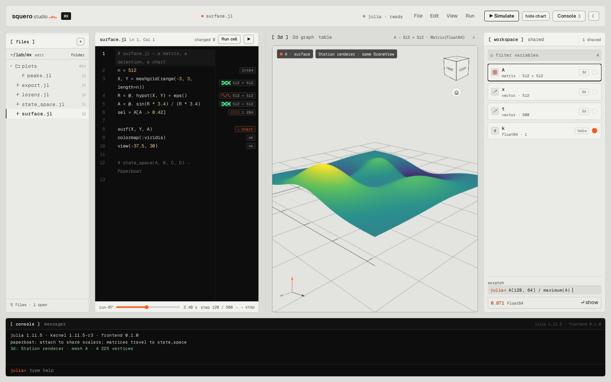

Squero Studio MX
================

An open-source, **MATLAB-like workbench** for Paperboat. MX is the MATLAB side: scripts, matrices,
a live workspace, 2D graphs and 3D plots. Paperboat is the Simulink side: flow graphs,
``state_space``/``rhs`` blocks, the in-house solvers, runs and signals.

MX is **not** a MATLAB compatibility product. It does not run ``.m`` files; it gives the feel
(1-based indexing, ``A'*A``, ``A\b``, ``.*``, ``end``, a command line, a workspace) on a Julia kernel.

.. toctree::
   :maxdepth: 1

   getting_started
   editor
   console
   workspace
   import
   figures
   files
   kernel

