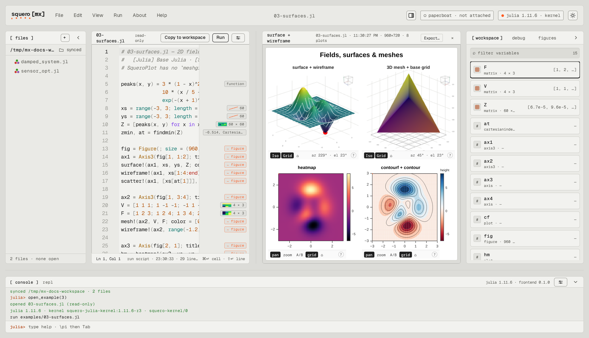

Squero Studio MX
================

**Squero Studio MX** is an open-source, MATLAB-style workbench built on a Julia kernel and wired
directly to Paperboat's solvers and simulation engine. It pairs a persistent workspace, grid
variable editor, interactive 2D/3D figures, and visual debugger with Paperboat's optimization
(OSQP, Ipopt) and dynamical-system simulation (`state_space`, `rhs`) blocks.

MX is **not** a MATLAB compatibility clone—it does not run ``.m`` files. Instead, it gives you an
interactive scientific workbench (1-based indexing, ``A' * A``, ``A \ b``, ``.*``, ``end``,
persistent workspace, cell execution) powered by Julia 1.11, with ``SqueroPlot`` and
``SqueroBase`` preloaded in every session.

What MX adds beyond standard Julia
----------------------------------

- **Persistent session workbench**: run whole scripts, ``#%%`` cells (``Ctrl/Cmd+Enter``), or
  single lines (``Shift+Enter``) while inspecting inline values and a live ``[ workspace ]`` pane.
- **Interactive grid variable editor**: double-click any vector or matrix (or run ``openvar A``) to
  inspect and edit entries in a spreadsheet grid or paste tabular data straight in.
- **Preloaded ``SqueroPlot`` + figure history**: draw 2D charts and interactive 3D surfaces with
  zero setup, inspect past runs side by side in ``[ figures ]``, and export to PNG, SVG, EPS, PDF,
  or standalone HTML.
- **Visual debugger**: set gutter or conditional breakpoints and step through Julia functions with a
  live call stack, locals, and watch expressions.
- **Direct Paperboat bridges (``SqueroBase``)**: solve LP/QP/NLP problems via ``optimize(...)`` in
  Paperboat's C++ solvers, automatically broadcast workspace variables to running Paperboat
  backends, and launch ``state_space`` / ``rhs`` simulations straight from the workbench.

.. toctree::
   :maxdepth: 1
   :caption: Start here

   getting_started
   tutorial
   examples

.. toctree::
   :maxdepth: 1
   :caption: Workbench

   editor
   console
   workspace
   figures

.. toctree::
   :maxdepth: 1
   :caption: Environment

   files
   kernel
