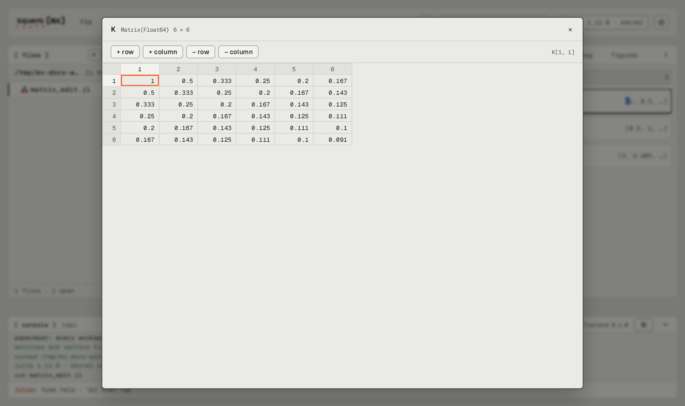
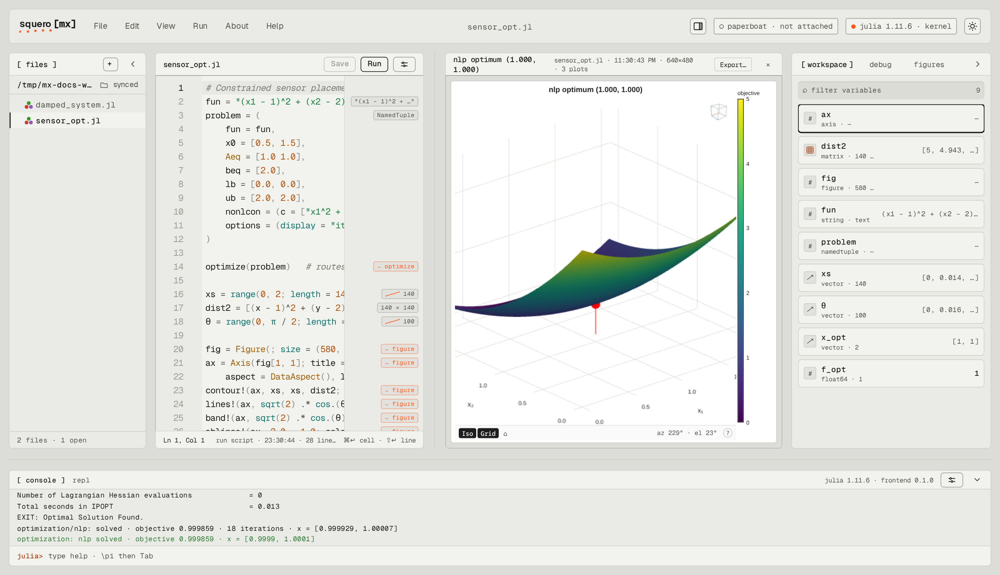

Tutorial: Beyond Standard Julia
===============================

Standard Julia gives you a fast language and REPL, but not an integrated spreadsheet variable
editor, C++ constrained optimization solvers wired straight into your session variables, or live
coupling to a block-diagram simulation engine. This short tutorial walks through all three using
built-in features of Squero Studio MX.

Because ``SqueroBase`` and ``SqueroPlot`` are preloaded by the kernel, every snippet below runs
without extra ``using`` imports.

Part 1 — Inspect and edit data in the Variable Editor
-----------------------------------------------------

Create a new script (click **+** in the Files rail, e.g. ``matrix_edit.jl``) and run it with
**Run**:

.. code-block:: julia

   # Build a 6×6 Hilbert-like matrix and a vector
   K = [round(1 / (i + j - 1); digits = 3) for i in 1:6, j in 1:6]
   v = [0.5, 1.0, 1.5, 2.0, 2.5, 3.0]
   y = K * v

Notice two things right away:

- Inline badges appear beside the lines in the editor showing dimensions and preview values.
- The **workspace** pane on the right lists ``K``, ``v``, and ``y`` with their types and shapes.

Now double-click ``K`` in the **workspace** pane (or type ``openvar K`` in the console) to open it
in the grid editor:

1. Click any cell (or move with arrow keys), type a new number, and press ``Enter`` or ``Tab``.
   The updated matrix is written straight back to the Julia kernel immediately.
2. Use **+ row**, **+ column**, **− row**, or **− column** to resize the array, or copy a block
   of cells from a spreadsheet and paste directly into the grid.
3. If you want to clean up temporary variables later without wiping your figure history, call
   ``clear(:v, :y)`` in the console—unlike restarting Julia, your plotted figures stay available in
   the **figures** tab.

Part 2 — Solve constrained optimization with Paperboat
------------------------------------------------------

In standard Julia, constrained LP, QP, and NLP problems require installing and wiring external
solver packages and manually unpacking result structs. In MX, ``SqueroBase.optimize`` packages a
plain Julia ``NamedTuple`` and routes it to Paperboat's built-in C++ **OSQP** (LP/QP) or
**Ipopt** (NLP) solver.

Suppose you want to place a sensor at :math:`(x_1, x_2)` as close as possible to target
:math:`(1, 2)`, constrained to stay on the walkway :math:`x_1 + x_2 = 2` and inside the circular
coverage region :math:`x_1^2 + x_2^2 \le 2`:

Create ``sensor_opt.jl`` and run it:

.. code-block:: julia

   # Constrained NLP routed to Paperboat's Ipopt solver
   fun = "(x1 - 1)^2 + (x2 - 2)^2"
   problem = (
       fun = fun,
       x0 = [0.5, 1.5],
       Aeq = [1.0 1.0],
       beq = [2.0],
       lb = [0.0, 0.0],
       ub = [2.0, 2.0],
       nonlcon = (c = ["x1^2 + x2^2 - 2"],),
       options = (display = "iter", tol = 1e-8),
   )

   optimize(problem)   # solves in Paperboat; binds x_opt and f_opt in MX

   # Visualize the objective contours, constraints, and optimum
   xs = range(0, 2; length = 140)
   dist2 = [(x - 1)^2 + (y - 2)^2 for x in xs, y in xs]
   θ = range(0, π / 2; length = 100)

   fig = Figure(; size = (580, 500), title = "NLP: sensor placement")
   ax = Axis(fig[1, 1]; title = "Sensor placement", xlabel = "x₁", ylabel = "x₂",
       aspect = DataAspect(), limits = (0, 2, 0, 2))
   contour!(ax, xs, xs, dist2; levels = 10, colormap = :grays)
   lines!(ax, sqrt(2) .* cos.(θ), sqrt(2) .* sin.(θ); color = :teal, linewidth = 2, label = "coverage |x| = √2")
   band!(ax, sqrt(2) .* cos.(θ), zeros(100), sqrt(2) .* sin.(θ); color = (:teal, 0.12))
   ablines!(ax, 2.0, -1.0; color = :orange, linewidth = 2, label = "walkway x₁ + x₂ = 2")
   scatter!(ax, [1.0], [2.0]; marker = :xcross, markersize = 14, color = :black, label = "target")
   scatter!(ax, [1.0], [1.0]; color = :crimson, markersize = 12, label = "optimum (1, 1)")
   annotation!(ax, 1.45, 0.45, 1.0, 1.0; text = "distance² = 1")
   axislegend(ax; position = :lb)
   fig

Look at what MX does automatically:

- **Console**: streams Ipopt's iteration trace and summary
  (``optimization/nlp: solved · objective 0.999859 · 18 iterations · x = [0.999929, 1.00007]``).
- **Workspace**: binds ``x_opt`` (``[1, 1]``) and ``f_opt`` (``1``) directly into your Julia
  session so downstream Julia code can use them right away.
- **Figures**: renders both your 2D contour plot and an interactive 3D objective surface with a red
  optimum marker and drop line in the **figures** history.

.. tip::

   Switching ``fun`` / ``nonlcon`` to ``f`` (linear cost) selects **LP**, and adding a quadratic
   Hessian ``H`` selects **QP** through the same ``optimize(problem)`` call. See
   ``09-optimization-lp.jl`` and ``10-optimization-qp.jl`` via ``open_example(9)`` and
   ``open_example(10)``.

Part 3 — Broadcast variables and simulate on Paperboat
------------------------------------------------------

MX never tries to re-implement Paperboat's ODE/DAE solvers in Julia. Instead, it connects to any
running Paperboat backend and lets you drive simulations straight from your Julia workspace:

1. **Automatic variable broadcast**: every scalar, vector, and matrix (up to 4096 entries) in the
   MX workspace is pushed to attached Paperboat backends automatically. When a Paperboat flow uses
   a variable matching a name in your MX workspace, editing that variable in MX updates the
   backend live.
2. **State-space / ODE simulation**: define ``A, B, C, D, x0`` (for a linear state-space model) or
   an ODE right-hand side string ``f`` (with ``x0``) in Julia:

.. code-block:: julia

   using LinearAlgebra

   m, c, k = 1.0, 0.6, 4.0
   A = [0.0 1.0; -k/m -c/m]
   B = [0.0; 1/m;;]
   C = [1.0 0.0]
   D = [0.0;;]
   x0 = [1.0, 0.0]

   # Queue a Paperboat simulation run directly from Julia:
   matrix(M) = join([join(M[i, :], " ") for i in axes(M, 1)], "; ")
   graph = (
       nodes = [
           (id = "plant", type = "state_space",
            params = (A = matrix(A), B = matrix(B), C = matrix(C), D = matrix(D),
                      x0 = join(x0, "; "), domain = "s")),
           (id = "y_plot", type = "graph", params = NamedTuple()),
       ],
       edges = [(from = ["plant", "y"], to = ["y_plot", "in"])],
   )
   simulate(graph; duration = 10, dt = 0.01, solver = :rk45)

Start any Paperboat backend (for example ``paperboat start`` in a terminal), and the top-bar chip
switches to ``paperboat · 1 attached``. You can then either:

- Run the script above to dispatch ``graph.run`` via ``simulate(...)``, or
- Click **Run** in the **simulation run dock** that automatically appears at the bottom of the
  Figures stage whenever ``A, B, C, D, x0`` or ``f`` are present in the workspace—pick a solver
  (``auto``, ``rk4``, ``rk45``, ``cvode``, ``ida``, …), step ``dt``, and duration, and MX charts
  the returned signals right in the stage.
