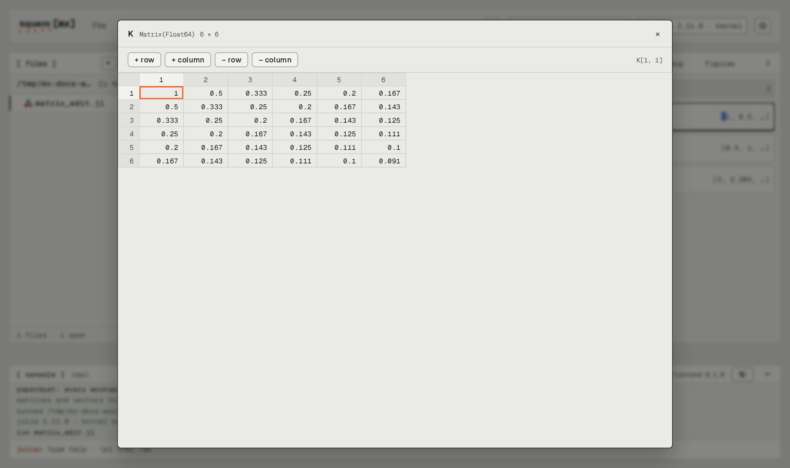

Workspace, data import, and Paperboat link
==========================================

Like MATLAB's, the MX **workspace** belongs to the **session** rather than any individual script.
Running a script adds or updates variables in the session, and switching between files leaves your
workspace intact until you clear it.

Managing the workspace
----------------------

- ``clear()`` (or **Edit ▸ Clear workspace**, or ``clear`` in the console) resets the Julia session
  and empties the workspace while preserving your **figures** history.
- ``clear(:scratch_a, :scratch_b)`` drops only the named bindings; in a script, ``clear()`` takes
  effect between statements so bindings created after it remain.
- Functions appear in the workspace list with a ``ƒ`` badge (they stay local to Julia).
- Use the **filter variables** input (or **Edit ▸ Find variables…**) to filter by name, shape, or
  type.
- A **scratch** evaluator at the bottom of the workspace pane lets you run quick one-off
  expressions.

The Variable Editor
-------------------

Double-click any variable card (or select it and choose **Edit ▸ Open variable**, or run
``openvar K`` in the console) to inspect and edit scalars, vectors, or matrices in a grid:

- **Navigate and edit**: move with arrow keys, type a number or press :kbd:`Enter` / :kbd:`F2` to
  edit a cell, press :kbd:`Enter` or :kbd:`Tab` to commit and advance, or :kbd:`Esc` to cancel.
- **Resize**: use **+ row**, **+ column**, **− row**, and **− column** to change dimensions.
- **Spreadsheet paste**: paste a rectangular block copied from Excel, LibreOffice Calc, or Google
  Sheets; it fills from the active cell and grows the matrix if needed.

Every edit updates the live binding in the Julia kernel right away.

Importing and exporting data
----------------------------

Choose **File ▸ Import data…** or drag and drop a file onto the **workspace** pane. A preview
dialog lets you inspect variables and resolve name conflicts before loading:

- ``.csv``, ``.tsv``, ``.txt``, ``.dat``: delimiter (comma, tab, semicolon, or whitespace) is
  detected automatically. A leading row of names creates one vector per column (non-numeric text
  columns are listed and skipped); headerless files load as a single matrix.
- ``.xlsx``: imports every worksheet; formula cells load with their cached values.
- ``.mat``: reads MATLAB v4, v6, and compressed v7 files. (v7.3 files use HDF5—re-save with
  ``save(..., "-v7")`` in MATLAB/Octave to import.)
- ``.json``: numbers, arrays, arrays of rows, or arrays of objects such as
  ``[{"t": 0, "y": 1}, ...]``.

To export the current workspace back to MATLAB or Octave, choose **File ▸ Export workspace
(.mat)…**, which writes a MAT v4 file containing numeric scalars, vectors, and matrices.

Automatic Paperboat variable broadcast
--------------------------------------

Whenever one or more Paperboat stations are running (shown in the top bar as
``paperboat · N attached``), MX automatically broadcasts workspace changes via ``variables.set``:

- **Scalars** are sent as Paperboat numbers.
- **Vectors and matrices** are sent as Paperboat ``matrix`` variables (vectors as column matrices)
  up to **4096** elements.
- Arrays larger than 4096 elements are not truncated or sampled silently: MX sends a diagnostic note
  with the shape and limit, suggesting you bind a smaller slice (such as ``B[1:10, 1:10]``).
- Functions and non-numeric Julia objects stay in MX and are not broadcast.
